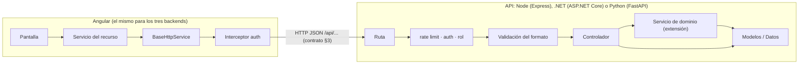

# Estándar de arquitectura Angular + Node.js / .NET / Python

Esta skill fija **cómo se organiza** una aplicación, no **qué hace**: sirve igual
para clientes, pedidos, reservas, porras o informes. Pensada para aplicaciones de
gestión, paneles y SaaS pequeños o medianos, con un equipo de 1 a ~6 personas que
despliega frontend y backend juntos.

**Un frontend, tres backends.** El frontend es siempre el mismo. El backend es Node.js,
.NET **o** Python (FastAPI), uno por proyecto; los tres tienen las mismas capas y
hablan el mismo contrato (§3), así que el frontend funciona sin cambios con
cualquiera. El diseño de
la base de datos queda fuera: el backend la ve a través de su capa de datos.

| Nivel | Qué incluye | Se puede saltar si… |
|---|---|---|
| **Obligatorio** | Capas y sentido de las dependencias (§1), propietario de los datos (§2), contrato y forma de los errores (§3), configuración validada al arrancar, validación en el servidor, `BaseHttpService` en el frontend, pruebas mínimas. | Nunca sin decirlo y anotarlo en `docs/decisiones.md`. |
| **Por defecto** | Árbol de carpetas, nombres, librerías, procedimiento (§6). | El proyecto ya tiene otra convención coherente: manda la suya. |
| **Extensión** | Servicios de dominio, integraciones, trabajos en segundo plano, caché, capacidades, carpetas por funcionalidad. | Hasta que se cumpla su criterio (`references/calidad.md` §8). |

En las referencias, **[O]** marca una práctica *observada* en los proyectos de los
que sale el estándar y **[R]** una *recomendación* que corrige algo que fallaba.

## Por dónde empezar

Lee esta página entera y después **solo** la referencia de tu tarea. Están en
`references/` junto a este fichero; la plantilla, en `plantilla/`.

| Tu tarea | Lee | Y usa como modelo |
|---|---|---|
| **Proyecto nuevo** (cualquier dominio) | `references/proyecto-nuevo.md` → la referencia de tu backend → `references/frontend.md` | Copia `plantilla/`. No escribas la estructura desde cero. |
| **Funcionalidad, entidad o pantalla nueva** | §6 de esta página → `references/backend-node.md`, `backend-dotnet.md` o `backend-python.md` → `references/frontend.md` | El recurso `productos` de la plantilla (o uno parecido del propio proyecto). |
| **Revisar código o un cambio**, o adaptar código que no nació de la plantilla | `references/revision.md` → la referencia de su backend | — |
| **¿Dónde va esto?** | §4 de esta página | — |
| Visión artificial (detección en imágenes o vídeo) | `references/backend-python.md` §13 | — |
| Errores, autenticación, seguridad, pruebas, logs | `references/calidad.md` | — |
| Un módulo ha crecido / ¿añado una capa? | `references/calidad.md` §8 | — |
| Por qué el estándar dice algo; convenciones de castilfac, castilfootball o 2-DAW | `references/proyectos-de-referencia.md` (descriptivo, no son instrucciones) | — |

¿Qué backend tiene el proyecto? `backend/package.json` con `express` → Node;
`backend/**/*.csproj` → .NET; `backend/pyproject.toml` con `fastapi` → Python. ¿Nació
de la plantilla? Tiene `BaseHttpService`, `utils/acceso.js`, `Utils/Acceso.cs` o
`app/utils/acceso.py`, y `ErrorHttp`. **Proyecto nuevo sin backend indicado**: pregunta
cuál (Node, .NET o Python) antes de empezar; no lo elijas tú.

## Reglas para el agente

1. **Inspecciona antes de tocar.** Lee la composición (`app.js`, `Program.cs` o `main.py`),
   `app.config.ts`, `app.routes.ts` y una pieza de cada capa de la funcionalidad más
   parecida a la que vas a hacer. No deduzcas la arquitectura por los nombres de
   carpeta.
2. **Manda la convención del proyecto** cuando es coherente: si llama
   `getClientes` a lo que aquí es `listarClientes`, o su JSON va en camelCase,
   sigues así en ese proyecto. El estándar manda en los proyectos nuevos y en lo
   obligatorio.
3. **No crees una segunda arquitectura en paralelo.** Si hay `BaseHttpService`, no
   uses `HttpClient` a pelo; si hay logger, nada de `console.log` ni `print`; si hay helper de
   propietario, úsalo.
4. **Reutiliza antes de crear**: validadores, DTOs, límites, interfaces,
   componentes compartidos, helpers.
5. **No añadas dependencias, capas ni patrones** que la tarea no necesite: una
   interfaz con una sola implementación, un repositorio encima del ORM o un store
   global para una pantalla son ruido.
6. **Frontend, backend y contrato cambian juntos.** Un campo nuevo en la respuesta
   lleva su interfaz TS, su validación, sus límites gemelos y sus textos en el mismo
   cambio.
7. **Cambio localizado antes que refactor.** No muevas ni renombres lo que la tarea
   no toca; apúntalo.
8. **No cambies el contrato ni la lógica de negocio ajenos a la tarea** sin ver
   quién los consume (`references/revision.md`).
9. **Señala los conflictos.** Si el estándar y el código existente chocan en algo
   estructural, dilo y propón la migración antes de hacerla.
10. **Un backend por proyecto**: lo de Node se aplica a Node, lo de .NET a .NET y lo
    de Python a Python; no se mezclan patrones.
11. **Verifica antes de dar algo por hecho**: pruebas del backend, `npx ng build` sin
    avisos y `ng test`; cada prueba nueva tiene que fallar si quitas lo que protege.
    Lo que no hayas podido comprobar, dilo en el resumen.

## 1. Arquitectura



**Capas del backend** (la misma en los tres; carpetas en minúscula en Node y Python,
en PascalCase en .NET):

| Responsabilidad | Node (`backend/src/`) | .NET (`backend/Api/`) | Python (`backend/app/`) | No hace |
|---|---|---|---|---|
| Composición: seguridad, CORS, JSON, rutas, 404, errores | `app.js` (+ `server.js` arranca) | `Program.cs` | `main.py` (+ `servidor.py` arranca) | Lógica de negocio |
| Configuración validada al arrancar | `config.js` | `Configuration/` | `config.py` | Leerse desde otro sitio |
| Rutas | `routes/` | atributos en el controlador | `routes/` (ruta y acción juntas) | Lógica |
| ¿Quién eres? ¿Puedes? ¿Cuántas veces? | `middlewares/` | `Middlewares/` + `[Authorize]` | `dependencias/` (`Depends`) | Validar un campo |
| Formato de la entrada | `validators/` | `Dtos/` (DataAnnotations) | `schemas/` (Pydantic) | Consultar datos |
| Traducir HTTP ↔ dominio | `controllers/` | `Controllers/` | `routes/` | Hablar con proveedores a pelo |
| Reglas reutilizables *(extensión)* | `services/` | `Services/` | `services/` | Conocer la petición |
| Entidades y acceso a datos | `models/` + `data/` | `Models/` + `Data/` | `models/` + `data/` | Reglas de negocio |
| Errores, propietario, límites, utilidades puras | `utils/` | `Utils/` | `utils/` | — |
| Tareas de consola | `scripts/` | `Scripts/` | `scripts/` | — |
| Pruebas | `tests/` | `Api.Tests/` | `tests/` | — |

**Frontend** (`frontend/src/app/`): `app.config.ts` (proveedores globales),
`app.routes.ts` (todo con `loadComponent`, zonas con layout), `guards/` y
`interceptors/` (funcionales), `services/` (uno por recurso, `extends
BaseHttpService`), `interfaces/` (lo que devuelve la API, campo a campo), `pipes/`,
`shared/` (constantes gemelas del backend), `components/<zona>/<recursos>/` (la
pantalla **padre** con el estado en signals y sus **hijos** de presentación con
`input()`/`output()`), `components/compartidos/`.

**Recorrido de una petición**:

```
[Pantalla] servicio.actualizar(id, datos) → BaseHttpService.put → interceptor (+Bearer; 401 → renueva una vez → reintenta)
── HTTP ──
Node:  router /api/x → rateLimit? → autenticar → autorizar('admin') → validador → comprobarValidacion
.NET:  [Route("api/x")] → [EnableRateLimiting]? → [Authorize(Roles=…)] → DTO validado por [ApiController]
Python: APIRouter(prefix="/api/x") → Depends(autenticar) → Depends(autorizar("admin")) → schema de Pydantic → limitador?
       (el limitador de slowapi es un decorador: corre después de validar, así que un 400 no gasta intentos)
       (formato mal → 400 { message, errors } sin llegar al controlador o a la función de la ruta)
Controlador: 1 cargar por id · 2 ¿es del propietario del token? no → 404 · 3 regla de negocio no → 409/422 { message, tipo }
             · 4 guardar SOLO los campos permitidos · 5 responder 200/201 con la entidad, sin campos sensibles
── HTTP ──
BaseHttpService: error → ErrorApi { status, message, tipo } → [Pantalla] pinta e.message o reacciona a e.tipo
```

**Dependencias permitidas** (lo de la izquierda puede usar lo de la derecha):

```
Node:      routes → middlewares, validators, controllers · controllers → services, models, utils
           services → models, utils · models → data, utils · validators → utils
           middlewares → utils · data → config, models, utils · utils → config
.NET:      Controllers → Dtos, Services, Data, Models, Utils, Middlewares (solo nombres de políticas)
           Services → Data, Models, Dtos, Utils, Configuration · Models → Utils
           Data → Models, Configuration · Dtos → Utils, Models (solo respuestas que llevan una entidad)
           Middlewares → Utils, Services, Configuration
Python:    routes → dependencias, schemas, services, models, data, utils · services → models, utils
           dependencias → utils · schemas → utils · models → data, utils · data → config, utils · utils → config
           vision → utils, config (nunca routes ni models: recibe una imagen y devuelve datos) · routes → vision
Frontend:  components → services, interfaces, shared, pipes, components/compartidos
           services → BaseHttpService, interfaces, environments · guards/interceptors → services
           interfaces → shared (solo para derivar tipos de constantes) · shared → nada
```

Prohibido: un controlador que usa otro controlador, un modelo que depende de un
controlador, un validador, DTO o schema que consulta la BD, un componente que importa
`HttpClient`. Los ciclos se rompen extrayendo lo común, no con `forwardRef`/`Lazy<T>`.

## 2. Propietario de los datos

La plantilla es multi-inquilino: todo pertenece a una **organización**
(`organizacion_id`). Con una sola empresa se deja igual, con una única organización:
quitarla cuesta mucho y no aporta nada. Dentro de la organización, cada recurso es:

- **De la organización**: todos los de la empresa lo ven; quién escribe lo decide el
  rol (productos, clases, pistas).
- **De un usuario**: cada uno ve lo suyo y el admin todo (reservas, porras):
  `usuario_id` del token y un helper que deja pasar al dueño y al admin.

En todos los casos: la identidad sale **del token**, nunca del cuerpo ni de la URL;
el recurso pasa por el helper (`asegurarPropietario` o `asegurarDueno`; en Python,
`asegurar_propietario`) y un
recurso ajeno responde **404**, no 403; los listados se piden **ya filtrados**; una
referencia a otro recurso (`categoria_id`) se comprueba (existe y es del mismo
propietario; si no, 400 `REFERENCIA_INVALIDA`). Código de los dos helpers y cómo
quitar la organización si de verdad hace falta: `references/proyecto-nuevo.md` §3.

## 3. Contrato común

Es lo que permite que el mismo frontend funcione con Node, con .NET y con Python. Un proyecto
nuevo lo respeta aunque solo tenga uno.

| Aspecto | Contrato |
|---|---|
| Rutas | `/api/<recursos>` en plural y kebab-case; rutas literales además de `/:id` |
| Campos JSON | `snake_case` (`organizacion_id`, `fecha_creacion`), iguales en la respuesta y en la interfaz TS. Excepción: `accessToken` y `refreshToken` |
| Ids | opacos: `Id = number \| string` en el frontend (SQL da números, Mongo texto) |
| Fechas | ISO 8601 en UTC con `Z` (`2026-10-20T08:30:00.000Z`; el número de decimales puede variar: no se comparan como texto); un día sin hora, `2026-10-20` |
| Crear | `201` con la entidad creada |
| Leer, actualizar | `200` con la entidad (PUT parcial: lo que no llega no cambia) |
| Borrar | `200 { message }` |
| Cambios de estado | `POST /api/<recursos>/:id/<accion>` en infinitivo (`/pedidos/42/cancelar`, `/pedidos/42/marcar-listo`), sin cuerpo o con lo mínimo; `200` con la entidad. Desde un estado que no lo permite, 409 `ESTADO_INVALIDO`. No con un `PUT` que deje cambiar `estado` libremente |
| Listas | el array tal cual; vacía = `200 []`, nunca 404 |
| Envoltorio | **ninguno**: ni `{ data }` ni `{ message, entidad }`. Si un proyecto existente envuelve, se desenvuelve una vez en `BaseHttpService` |
| Error | `{ message, tipo?, errors? }` — `message` en castellano para la persona; `tipo` estable en MAYÚSCULAS cuando el frontend reacciona; `errors: [{ campo, mensaje }]` solo en validación |
| Códigos | 400 formato o referencia inválida · 401 sin sesión · 403 sin permiso · 404 no existe o no es tuyo · 409 choca con el estado de otro dato (duplicado, en uso, transición no permitida) · 422 regla del negocio sobre los propios datos (fecha pasada, fuera de horario) · 429 rate limit · 500 genérico, sin detalle |
| Sesión | `POST /api/auth/login` → `{ accessToken, refreshToken, usuario }` · `POST /api/auth/renovar` · `GET /api/auth/yo` |
| Salud y 404 | `GET /api/salud` → `{ estado: "ok" }`; ruta desconocida → 404 `{ message }` |
| Puerto local | 3000 en los tres backends |

`tipo` de la plantilla: `SESION_CADUCADA` (la renovación ya falló: el interceptor
renueva ante **cualquier** 401, sin mirar el `tipo`), `NOMBRE_REPETIDO` (el
formulario lo pinta junto al campo), `DUPLICADO` (el índice único frenó una carrera)
y `CORS` (403 de un origen no permitido, en Node y Python); del estándar, para cuando hagan
falta: `REFERENCIA_INVALIDA`, `EN_USO` y `ESTADO_INVALIDO`. Node y Python responden además 413 si el cuerpo pasa
de 100 KB. Los campos sensibles (hash) se quitan en el propio
modelo en Node y .NET, y en Python no se declaran en el schema de respuesta; en ningún caso
se quitan a mano en cada controlador. Lo que la pantalla necesita ya unido (el nombre de
la categoría en el producto) lo compone el backend. Añadir campos opcionales nunca
rompe; quitar, renombrar o cambiar la forma sí (`references/calidad.md` §9).

## 4. Dónde va cada cosa

Rutas en orden Node / .NET / Python.

1. ¿Lee configuración o variables de entorno? → `config.js` / `Configuration/` / `config.py`.
2. ¿Comprueba el formato de la entrada sin consultar nada? → `validators/` / `Dtos/` / `schemas/`.
3. ¿Aplica a muchas rutas y depende solo de quién llama? → `middlewares/` / `Middlewares/` o un atributo / `dependencias/`.
4. ¿Regla de negocio usada desde un solo sitio? → el controlador (en Python, la función de la ruta).
5. ¿La usan **dos sitios** —dos acciones (aunque sean del mismo controlador), dos
   controladores, un middleware o un trabajo— o coordina varias entidades, o el
   controlador pasa de ~300 líneas? → `services/` / `Services/` / `services/`.
6. ¿Habla con un proveedor externo (correo, pagos)? → `src/mailer.js` o
   `integraciones/` en Node; `Services/` con interfaz en .NET; `app/integraciones/` en Python.
7. ¿Función pura sin estado? → `utils/` / `Utils/` / `utils/` en el backend, `shared/` en el frontend.
   ¿Visión artificial (modelo, inferencia, geometría)? → `app/vision/` (`backend-python.md` §13).
8. ¿Regex, enumerado o límite que también valida el formulario? → el fichero de
   límites del backend **y** su gemelo `shared/regex.ts`, con el mismo valor.
9. ¿Estado de una pantalla? → `signal` en el componente. ¿Un trozo que solo pinta y
   avisa? → hijo con `input()`/`output()`. ¿Formatear un valor? → un pipe.
10. ¿Estado que comparten varias pantallas? → servicio Angular con signals.
11. ¿Texto que ve el usuario? → si es un error, lo redacta el backend (`message`);
    si es de la interfaz, una clave en `public/i18n/*.json`.
12. ¿Una decisión que se aparta del estándar? → `docs/decisiones.md`.

## 5. Compartido frente a específico

Compartido es lo que **ya** usan dos sitios; una abstracción para un solo uso se
queda donde está. Lo compartido desde el día uno:

- `BaseHttpService` (frontend): URL base, verbos tipados y errores como `ErrorApi`.
- Límites gemelos: `utils/regex.js`, `Utils/Limites.cs` o `utils/limites.py` ↔ `shared/regex.ts`, con
  un comentario que lo diga en los dos. Si el formulario deja 200 caracteres y el
  backend 150, el usuario lo descubre con un error.
- Helper de propietario (`utils/acceso.js` / `Utils/Acceso.cs` / `utils/acceso.py`): toda comprobación
  de «¿esto es de quien llama?» pasa por él.
- `ErrorHttp` + manejador global: los controladores lanzan, no hacen `try/catch`.
- `NotificacionesService`: la única puerta a avisos y confirmaciones.

## 6. Procedimiento para una funcionalidad nueva

Cada paso deja algo que usa el siguiente. Los detalles de cada capa están en la
referencia de tu backend y en `references/frontend.md`.

1. **Explora** la funcionalidad más parecida (en un proyecto de la plantilla,
   `productos`) y sigue sus convenciones reales.
2. **Contrato antes del código**: tabla con método, ruta, quién puede, cuerpo,
   respuesta y errores con su `tipo`; se queda como comentario encima de cada acción
   del controlador (`// GET /api/x -> X[]`, como en la plantilla). Decide el
   propietario (§2).
3. **Entidad**: modelo y relaciones (Node: `associations.js` con `as` explícito;
   Python: `models/` y su import en `models/__init__.py`) o colección e índices
   (.NET: `MongoContexto`). Unicidad con índice único además de la comprobación.
   Node: si cambias una tabla que ya existe, su migración (`backend/migraciones/`).
   Python: **todo** cambio de modelo, también una tabla nueva, lleva su migración de Alembic.
4. **Constantes**: límites y enumerados en el fichero del backend y en `shared/regex.ts`.
5. **Formato de la entrada**: validador con `reglas(paraCrear)` (Node),
   `Crear…Dto`/`Actualizar…Dto` con todo anulable (.NET) o `Crear…`/`Actualizar…` con
   un validador por campo (Python). Mensajes en castellano.
6. **Controlador**: propietario del token, recurso por el helper, referencias
   comprobadas, regla de negocio lanzando `ErrorHttp`, solo los campos permitidos,
   códigos de §3. Sin `try/catch`.
7. **Servicio de dominio**, solo si §4.5 lo pide.
8. **Rutas y permisos**: Node, router con su prefijo en `app.js`; .NET,
   `[Authorize]` y roles en el controlador; Python, `APIRouter` con su prefijo y
   `include_router` en `main.py`.
9. **Pruebas del backend**: feliz, 400, 401, 403 (en cada acción que escribe), 404
   de otro propietario, 409 si hay regla de unicidad o de estado, y referencia ajena
   si hay relaciones; cada una se pone roja si quitas lo que protege.
10. **Interfaz TS** con los nombres exactos de la respuesta.
11. **Servicio Angular** que extiende `BaseHttpService`, un método por endpoint.
12. **Pantallas**: listado con tabla de Material y formulario único para crear y
    editar; estado en signals; cargando, vacío y error; suscripciones con
    `takeUntilDestroyed`.
13. **Rutas** con `loadComponent` bajo el layout de la zona, con sus guards, y el
    enlace en el menú.
14. **Textos**: claves en `es.json` y `en.json`; avisos por `NotificacionesService`.
15. **Verifica** (regla 11) y repasa el checklist.

## 7. Checklist

**Backend**
- [ ] Toda escritura y todo id tienen validación de formato, con los límites gemelos.
- [ ] El propietario sale del token; el recurso pasa por el helper; los listados se
      piden filtrados; las referencias se comprueban.
- [ ] Solo los campos permitidos al crear o actualizar.
- [ ] Errores con `ErrorHttp` y la forma de §3; los 500 no filtran detalles.
- [ ] Unicidad con índice único; migración para cada tabla existente que cambia (Node) o para
      cada cambio de modelo (Python).
- [ ] .NET: DTOs anulables, sin `ModelState.IsValid` a mano, sin `Forbid("…")`,
      `dotnet build` sin avisos.
- [ ] Python: funciones `def`, `response_model` en cada ruta que devuelve una entidad o una lista, ningún 422 ni texto de
      Pydantic en inglés, `uv run ruff check` limpio.
- [ ] Configuración nueva en su sitio y en `.env.example` / `appsettings.json`.
- [ ] Logs sin datos sensibles.

**Frontend**
- [ ] Interfaz TS = respuesta real, campo a campo; ids con `Id`.
- [ ] El servicio extiende `BaseHttpService`; ningún componente usa `HttpClient`.
- [ ] Carga diferida y guards; cargando, vacío y error.
- [ ] Formularios con los límites de `shared/regex.ts`; errores del servidor junto a su campo.
- [ ] Sin `any` ni `$any`; suscripciones con `takeUntilDestroyed`.
- [ ] Textos en todos los `public/i18n/*.json`; avisos por `NotificacionesService`.
- [ ] Controles de Material, maquetación con Tailwind, colores con los nombres del tema.
- [ ] Listados con tabla de Material (orden, paginación); en móvil caben las acciones.

**Cierre**
- [ ] Pruebas nuevas que fallan sin el cambio; todo en verde; `npx ng build` sin avisos.
- [ ] Decisiones y extensiones adoptadas, en `docs/decisiones.md`.
- [ ] El resumen dice qué no se ha podido verificar y qué se ha visto mejorable fuera de alcance.

## 8. La plantilla

`plantilla/` es una aplicación completa con un recurso de ejemplo, **`productos`**,
de una aplicación multi-inquilino: login con renovación de sesión, roles
`admin`/`usuario`, CRUD con validación, aislamiento por organización, nombre único,
tabla con orden y paginación, componente hijo, pipe, idiomas y modo oscuro.

```
plantilla/
├── frontend/          el único frontend (Angular 21)
├── backend-node/      backend/ + .env.example + docker-compose.yml + .gitignore
├── backend-dotnet/    lo mismo con .NET 10
├── backend-python/    lo mismo con Python 3.13 y FastAPI
└── docs/decisiones.md el modelo de registro de decisiones
```

Está probada: cada backend pasa sus pruebas de API (`npm test` / `dotnet test` /
`uv run pytest`), el frontend compila sin avisos y pasa sus pruebas de pipe,
servicio y componente, y el mismo frontend se ha recorrido en el navegador contra
cada uno de los tres backends.

Para aprender una petición entera, lee `productos` en este orden: modelo →
validador, DTO o schema → servicio → controlador o ruta → `app.js`, `Program.cs` o
`main.py` → pruebas; y en el frontend, `interfaces/producto.ts` →
`services/productos.service.ts` → `components/panel/productos/` (padre) →
`producto-acciones/` (hijo) → `producto-formulario/` → `app.routes.ts`. Los
comentarios de cada fichero explican el porqué; léelos.
