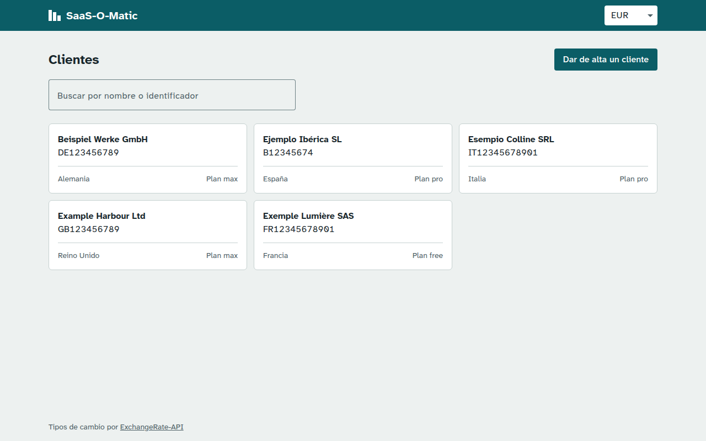
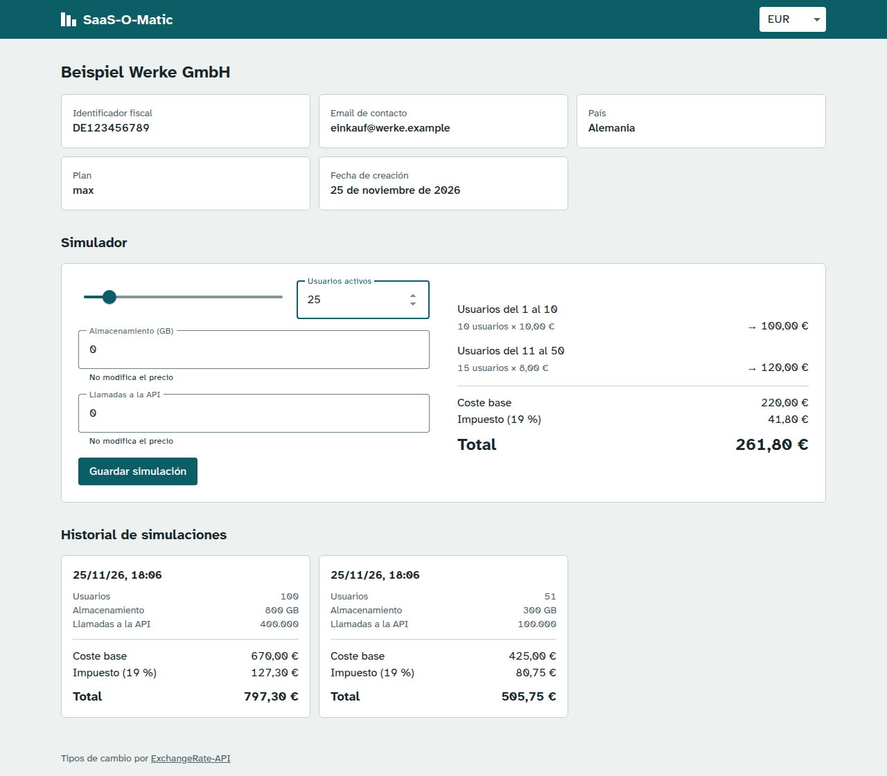
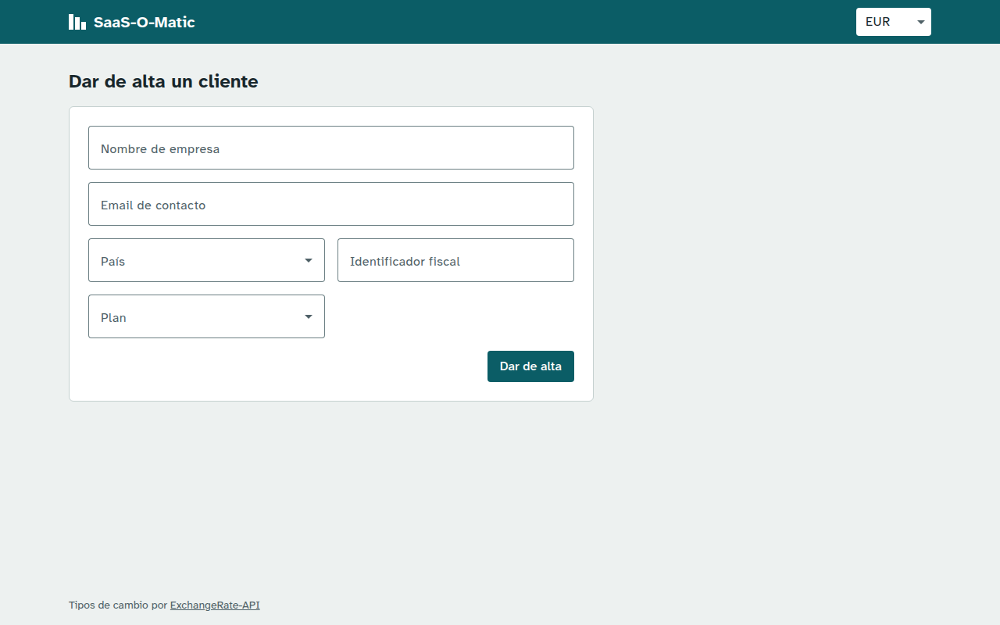

# SaaS-O-Matic

Herramienta interna para dar de alta clientes y simular cuánto pagarían por una suscripción SaaS,
con impuesto según su país y precios mostrados en varias divisas.

## Requisitos

- Node **22.12** o posterior (también vale la 24).
- npm **10** o posterior (el que trae Node 22).

## Arranque

Son **dos carpetas y dos terminales**. En la raíz no hay `package.json`: los comandos se lanzan
dentro de `backend/` y de `frontend/`.

**Terminal 1: backend** (API en http://localhost:3000)

```bash
cd backend
npm ci
npm run datos-ejemplo   # solo la primera vez: 5 clientes con sus simulaciones
npm run dev
```

**Terminal 2: frontend** (app en http://localhost:4200)

```bash
cd frontend
npm ci
npm start
```

Abre http://localhost:4200. La base de datos es `backend/datos.sqlite` y se crea sola.
Para usar otra, pon su ruta en la variable `DB_ALMACEN`.

## Con Docker

Sin instalar Node, desde la raíz:

```bash
docker compose up --build
```

Abre http://localhost:8080 (otro puerto: `PUERTO=9000 docker compose up --build`). La primera vez
carga los datos de ejemplo. El puerto solo escucha en `127.0.0.1`. La base de datos vive en el
volumen `saas-o-matic_datos` y sobrevive a `docker compose down`; `docker compose down -v` la borra.
Vale para amd64 y arm64.

## Pruebas

```bash
cd backend  && npm run tipos && npm test
cd frontend && npx ng test --watch=false
```

## Qué hace

- Busca clientes por nombre o identificador fiscal mientras escribes.
- Da de alta clientes y valida su identificador fiscal (en España, DNI, NIE o CIF).
- Simula el precio con un slider: coste por tramos de usuarios, el IVA del país y el total.
- Guarda las simulaciones y muestra el historial de cada cliente.
- Muestra los importes en otra divisa. Los tipos de cambio vienen de ExchangeRate-API, así que hace falta internet.

| Buscador                                  | Detalle y simulador                                 | Alta                              |
| ----------------------------------------- | --------------------------------------------------- | --------------------------------- |
|  |  |  |

## Estructura

```text
backend/        API REST: Express 5 + Sequelize + SQLite, en TypeScript
  src/          routes → validators → controllers → services → models
  scripts/      datos-ejemplo.ts
  tests/        Vitest, contra la app real y SQLite en memoria
frontend/       Angular 21 standalone + Material + Tailwind
  src/app/      components, services, interfaces, pipes, shared
docs/           decisiones.md (dónde nos apartamos de la arquitectura base) y capturas
ai-workspace/   spec, plan, prompts y diario del trabajo con IA
```

## Cómo se ha hecho

Con **desarrollo guiado por especificaciones** (_Spec-Driven Development_) y
**programación guiada con IA** (_vibe coding_), con las decisiones de
arquitectura, calidad y seguridad tomadas por mí en cada paso:

1. **Primero la spec, después el código.** Requisitos, contrato de la API,
   reglas de negocio y dudas de los requisitos resueltas antes de programar
   ([`01-SPEC.md`](ai-workspace/01-SPEC.md)), partidas en bloques pequeños
   con sus pruebas ([`02-PLAN.md`](ai-workspace/02-PLAN.md)).
2. **Reglas para la IA.** Mi estándar de arquitectura como skill
   ([`.claude/skills/`](.claude/skills/)), las reglas del proyecto
   ([`CLAUDE.md`](CLAUDE.md)) y dónde me aparto de él
   ([`docs/decisiones.md`](docs/decisiones.md)).
3. **Un bloque cada vez, revisado antes de seguir.** Claude Code programa;
   un segundo Claude revisa el informe de cada bloque; yo decido qué se
   acepta y qué se corrige. Todos los prompts, con sus correcciones, están
   en [`prompts/`](ai-workspace/prompts/).
4. **Control de calidad.** Pruebas que se rompen a propósito para comprobar
   que detectan fallos, una auditoría independiente del código y la lista
   de errores de la IA que se pararon por el camino
   ([`04-calidad/`](ai-workspace/04-calidad/)).

Para seguir el proceso de principio a fin:
[`ai-workspace/proceso.md`](ai-workspace/proceso.md). Por qué trabajé así:
[`metodologia.md`](ai-workspace/metodologia.md).

## Proceso con IA

Todo el proceso (borrador, spec, plan, prompts usados y auditoría) está en
[`ai-workspace/`](ai-workspace/). Para empezar, lee [`ai-workspace/proceso.md`](ai-workspace/proceso.md).
