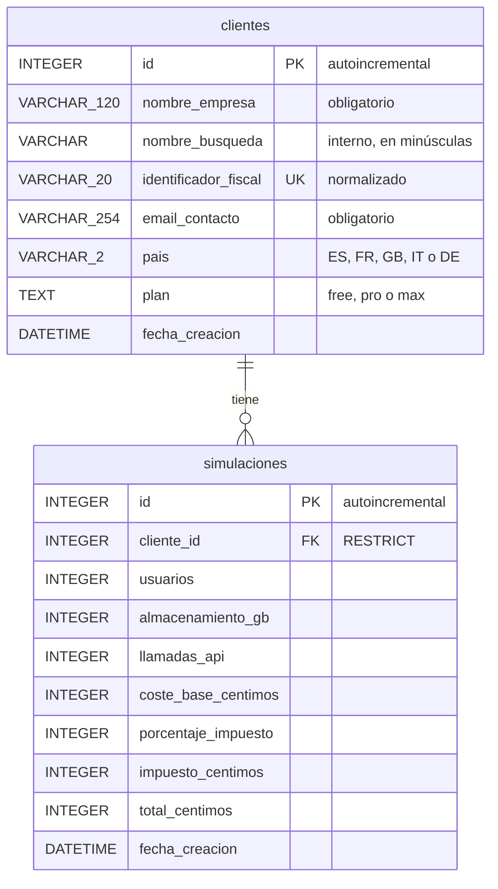

# Base de datos

Cómo está planteada la base de datos de SaaS-O-Matic y por qué. El modelo sale
de la spec (§2) y está implementado en `backend/src/models/`.

## Motor

**SQLite**, un único fichero (`backend/datos.sqlite`), como piden los requisitos.

- Las tablas se crean al arrancar (`sequelize.sync()`), sin servidor de base de
  datos ni Docker. Quien clona el repositorio no instala nada más.
- Las pruebas usan una base de datos en memoria: se crea y se destruye en cada
  ejecución.
- Se accede siempre a través del ORM (Sequelize), con consultas parametrizadas.
  La conexión está en un solo fichero (`data/db.ts`): cambiar de motor es
  cambiar ese fichero.

## Diagrama



## Esquema real

Es el SQL que genera la aplicación al arrancar, sacado de la propia base de datos:

```sql
CREATE TABLE `clientes` (
  `id` INTEGER PRIMARY KEY AUTOINCREMENT,
  `nombre_empresa` VARCHAR(120) NOT NULL,
  `nombre_busqueda` VARCHAR(255) NOT NULL,
  `identificador_fiscal` VARCHAR(20) NOT NULL,
  `email_contacto` VARCHAR(254) NOT NULL,
  `pais` VARCHAR(2) NOT NULL,
  `plan` TEXT NOT NULL,
  `fecha_creacion` DATETIME
);

CREATE UNIQUE INDEX `clientes_identificador_fiscal`
  ON `clientes` (`identificador_fiscal`);

CREATE TABLE `simulaciones` (
  `id` INTEGER PRIMARY KEY AUTOINCREMENT,
  `cliente_id` INTEGER NOT NULL
    REFERENCES `clientes` (`id`) ON DELETE RESTRICT ON UPDATE CASCADE,
  `usuarios` INTEGER NOT NULL,
  `almacenamiento_gb` INTEGER NOT NULL,
  `llamadas_api` INTEGER NOT NULL,
  `coste_base_centimos` INTEGER NOT NULL,
  `porcentaje_impuesto` INTEGER NOT NULL,
  `impuesto_centimos` INTEGER NOT NULL,
  `total_centimos` INTEGER NOT NULL,
  `fecha_creacion` DATETIME
);
```

## Decisiones

| Decisión                                                     | Por qué                                                                                                                                                                                                                  |
| ------------------------------------------------------------ | ------------------------------------------------------------------------------------------------------------------------------------------------------------------------------------------------------------------------ |
| **Clave propia (`id`), no el identificador fiscal**          | El identificador puede estar mal tecleado y necesitar corrección. Si fuera la clave, el cambio arrastraría a todas las simulaciones.                                                                                     |
| **Identificador fiscal único, con índice**                   | No puede haber dos fichas del mismo cliente. La comprobación del controlador da un mensaje claro, pero comprobar y guardar son dos pasos: el índice es la única garantía si llegan dos altas a la vez.                   |
| **El identificador se guarda normalizado**                   | `B-12.345.674` y `b12345674` son el mismo cliente. Normalizar antes de guardar hace que el índice único los detecte.                                                                                                     |
| **Dinero en céntimos enteros (`INTEGER`)**                   | Los decimales en coma flotante no son exactos (`0.1 + 0.2 ≠ 0.3`). El sufijo `_centimos` evita leerlos como euros.                                                                                                       |
| **La simulación guarda el resultado y el % de IVA**          | Es la foto del presupuesto de ese día. Si cambia el IVA o una tarifa, el historial no cambia.                                                                                                                            |
| **No se guarda el desglose por tramos**                      | Saldría de los tramos actuales, no de los del día, y podría no cuadrar con el total guardado.                                                                                                                            |
| **No se guarda el país en la simulación**                    | Sale del cliente. Al guardar, el IVA se calcula con el país del cliente, nunca con uno que llegue en la petición.                                                                                                        |
| **`ON DELETE RESTRICT`**                                     | No se puede borrar un cliente con simulaciones. `CASCADE` borraría su historial en silencio y `SET NULL` dejaría simulaciones sin cliente.                                                                               |
| **Columna `nombre_busqueda`**                                | SQLite solo ignora mayúsculas en letras sin tilde. Una copia del nombre en minúsculas permite buscar "ibérica" y encontrar "IBÉRICA", y ordenar sin que las mayúsculas vayan primero. Es interna: la API no la devuelve. |
| **Solo `fecha_creacion`**                                    | Ni clientes ni simulaciones se editan, así que no hay fecha de actualización.                                                                                                                                            |
| **País, plan, tramos e IVA como constantes, no como tablas** | Son listas cortas y cerradas que define el negocio. Como constantes, el frontend tiene una copia idéntica para los formularios, y no hace falta una pantalla para gestionarlas.                                          |
| **Almacenamiento y llamadas a la API, guardados sin precio** | Los requisitos piden registrarlos pero no les dan tarifa. Se guardan para cuando exista.                                                                                                                                     |

## Comprobado

- **La clave ajena se aplica de verdad.** En SQLite hay que activarla en cada
  conexión (`PRAGMA foreign_keys`). Sequelize lo hace solo, y se ha comprobado:
  insertar una simulación con un cliente que no existe falla con
  `FOREIGN KEY constraint failed`.
- **El índice único frena los duplicados**, incluso si se salta la comprobación
  del controlador (prueba de la carrera, B5).

## Limitaciones conocidas

- **`plan` es `TEXT` sin restricción en la base de datos.** SQLite no tiene
  `ENUM`: la lista de planes la impone el validador de la API, no la tabla.
- **No hay índice en `simulaciones.cliente_id`.** El historial filtra por esa
  columna y SQLite no indexa las claves ajenas solo. Con el volumen de una
  herramienta interna no se nota; si creciera, sería el primer índice a añadir.
- **Cambios de modelo sin migraciones.** `sync()` crea las tablas que faltan
  pero no modifica las existentes. Válido para una prueba en local; con datos
  reales que conservar, harían falta migraciones.

## Organización de carpetas

El backend se organiza por capas: cada petición baja de la ruta al modelo. El frontend, por
componentes, agrupados por pantalla.

```text
backend/
├── src/
│   ├── routes/        URL → validador → controlador
│   ├── validators/    limpian y validan la entrada; 400 si algo falla
│   ├── controllers/   leen lo validado, llaman al servicio y al modelo, y responden
│   ├── services/      reglas de negocio: tramos, impuesto y total (precios.service.ts)
│   ├── models/        tablas de Sequelize y sus relaciones
│   ├── data/          la conexión a SQLite (db.ts)
│   └── utils/         errores, logger, constantes (regex.ts) e identificador fiscal
├── scripts/           datos de ejemplo (npm run datos-ejemplo)
└── tests/             pruebas de Vitest, por endpoint y por utilidad

frontend/src/app/
├── components/
│   ├── clientes/      buscador, tarjeta, detalle, datos, alta y formulario
│   ├── simulaciones/  simulador, desglose del precio e historial
│   ├── compartidos/   piezas comunes: cargando y selector de divisa
│   ├── layout/        cabecera, pie y hueco para la página
│   └── no-encontrado/ página 404
├── services/          llamadas a la API (BaseHttpService), divisas y avisos
├── interfaces/        forma del JSON, campo a campo igual que la API
├── shared/            funciones puras (conversión de divisa) y constantes gemelas (regex.ts)
└── pipes/             formato de importes
```
